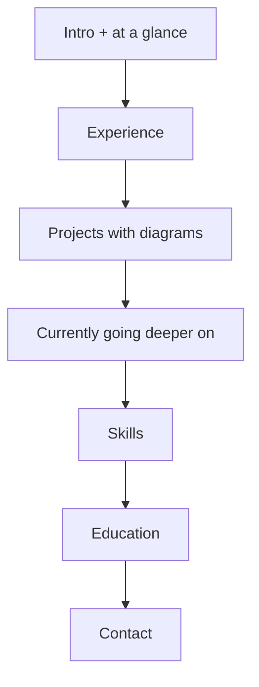

# Design direction (2026-10-22)

## Why the previous version read as amateur
- Everything was a card. A bento grid of same-weight bordered, shadowed boxes means nothing leads; the eye has nowhere to start.
- Tiny uppercase labels, muted text everywhere, pill badges on every block: decoration standing in for hierarchy.
- Effects doing the talking: cursor spotlight, scroll-reveal (content invisible until scrolled), force-directed skills graph.
- Four thin pages, so a recruiter had to click around to get the whole picture.

## Direction: an engineer's technical document
Calm, typographic, warm. It should read like a well-written design doc or a good engineering blog, not a template or a frontend showcase.

- **Typography carries the hierarchy.** Newsreader (serif) for the name and headings, DM Sans for body text, Geist Mono for metadata (dates, labels, stacks).
- **Rules, not boxes.** Sections are separated by a mono label and a hairline rule. Cards are used only for the architecture diagrams.
- **One page.** Everything a recruiter needs in one scroll: intro → experience → projects → learning → skills → education → contact. Old URLs (/experience/, /projects/, /about/) redirect to the matching section.
- **Two-column rows.** Dates and labels sit in a narrow left column (mono); content sits in the right. Collapses to one column on phones.
- **Diagrams are the visual interest.** The architecture diagrams for my own projects are the only "graphics", because they show how I think.
- **Motion is minimal.** A short fade-in on load, link underlines, the typing line. Nothing hides content.

## IA

Header anchors: Experience · Projects · About (learning, skills, education) · theme toggle.

## Tokens
Warm paper / warm ink, one accent (burnt sienna). Light: background `hsl(40 33% 97%)`, text `hsl(25 20% 12%)`, muted `hsl(25 8% 38%)`, rule `hsl(30 15% 86%)`, accent `hsl(18 60% 40%)`. Dark: background `hsl(25 15% 7%)`, text `hsl(35 20% 90%)`, muted `hsl(30 8% 64%)`, rule `hsl(25 8% 18%)`, accent `hsl(22 62% 64%)`. Body text ≥ 4.5:1 in both themes.

## Removed in this pass
Skills graph (and d3-force), spotlight cards, clay shadows, scroll-reveal, badge pills, the separate Experience/Projects/About pages.

---

## Revision 2 (2026-10-22): status dashboard
Ammar found the one-page document version bland and asked to try the "status dashboard" direction (other options, "living diagram" and "bold editorial", kept in reserve).

- **Home is a calm ops dashboard:** panels with a mono header strip (label + meta) on a faint dot-grid canvas. Overview, Now, Building, Learning, Focus up top; Experience, Projects, About (skills, education), Contact below.
- **Status dots carry meaning, not decoration:** sage = in role, amber = building / active development, slate = learning. Only the "Now" dot pulses. **No fake data:** no sparklines, gauges, or percentages.
- **Case-study pages** at `/projects/<slug>/` with summary, details, architecture diagram, and what I built. Home project cards link to them.
- Sans (DM Sans) for headings and body, Geist Mono for labels and chips; the serif was dropped.
- Width widened to `max-w-6xl` for the panel grid.
- **Light mode is the default** (toggle choice persists).
